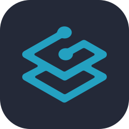
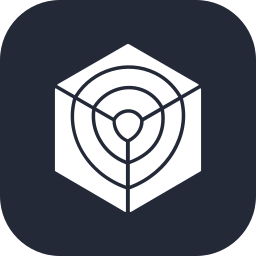

# Hello, I am Will!

  

---

DevOps and Site Reliability Engineer with expertise in multi-cloud environments. I work with containerization and orchestration using Docker and Kubernetes, infrastructure provisioning with Terraform, CI/CD pipelines and observability, as well as AIOps practices, applying artificial intelligence to improve the operation and reliability of systems.

##  Education

- **🎯 Bachelor's in Cloud Computing** – FIAP  
- **🏆 Next Champion 2024**
- **🏆 Next Champion 2025**
- **🤖 Postgraduate in AI for Developers** – FIAP *(in progress)*

---

##  Tools & Technologies

  
  
  
  
  
  
  
  
  
  
  
  
  
  
  
  
  
  
  
  
   
  
  
  
  
  
  
  
  
  
  
  
  
  
  
  
  
  
  
  
  

> DevOps/SRE, Cloud Computing and Automation with IaC.

---

##  Certifications

  

---

##  Let's Connect!

  
  
  

  

  

<picture align="center">
  <source media="(prefers-color-scheme: dark)" srcset="https://raw.githubusercontent.com/willtechdev/willtechdev/output/github-contribution-grid-snake-dark.svg">
  <source media="(prefers-color-scheme: light)" srcset="https://raw.githubusercontent.com/willtechdev/willtechdev/output/github-contribution-grid-snake-dark.svg">
  
</picture>
